# Real-Time Industrial Worker Safety & Hazard Zone Analytics Engine

An embedded-ready, zero-overhead **C++17** computer vision and spatial-temporal safety analytics engine built on **ONNX Runtime** and **OpenCV 4**. Designed for industrial edge deployments (manufacturing presses, high-voltage bays, automated logistics corridors), the engine performs multi-class PPE detection, anatomical spatial association, polygonal hazard-zone compliance checking, multi-object IoU tracking, and consecutive-frame violation de-bouncing across a lock-minimal Producer-Consumer pipeline.

---

## System Architecture

```mermaid
flowchart LR
    Cam["Frame Producer Thread\n(Camera / Synthetic Stream)"] -->|"std::move(cv::Mat)"| Queue["BoundedQueue&lt;cv::Mat&gt;\n(std::mutex + condition_variable)"]
    Queue -->|"Zero-Copy Tensor View"| Det["ONNX Detector\n(Letterbox + YOLOv8 NMS)"]
    Det -->|"std::vector&lt;Detection&gt;"| Geo["Spatial SafetyAnalyzer\n(Anatomical IoPA + Point-in-Polygon)"]
    Geo -->|"std::vector&lt;WorkerStatus&gt;"| Trk["WorkerTracker & FSM\n(Greedy IoU + Streak De-bouncing)"]
    Trk -->|"std::vector&lt;TrackedWorker&gt;"| Hud["HUD Renderer & Telemetry\n(Alpha Zones + AlertState Boxes)"]
```



```text
+--------------------+     push / push_drop_oldest     +---------------------------+
|  Producer Thread   | ------------------------------> |   BoundedQueue<cv::Mat>   |
| (Camera / Stream)  |                                 |  (RAII Mutex + CondVars)  |
+--------------------+                                 +-------------+-------------+
                                                                     | pop() -> std::optional<cv::Mat>
                                                                     v
+--------------------+    TrackedWorker    +-------------------------+-------------------------+
|    HUD Renderer    | <------------------ |                 SafetyPipeline                    |
|  Alpha Polygons &  |                     |  1. Detector       : Letterbox -> NCHW -> ORT     |
|  AlertState Boxes  |                     |  2. SafetyAnalyzer : IoPA Binding + Polygon Test  |
+--------------------+                     |  3. WorkerTracker  : Greedy IoU + FSM De-bouncing |
                                           +---------------------------------------------------+
```

---

## Key C++17 Systems & Vision Engineering Highlights

### 1. Zero-Allocation Steady-State Preprocessing & Zero-Copy ONNX Tensor Wrapping
- **`Detector` (`include/safety_engine/detector.hpp`, `src/detector.cpp`)** pre-allocates its contiguous planar `NCHW` buffer (`std::vector<float> input_tensor_values_`) and intermediate `cv::Mat` workspaces (`resized_buffer_`, `letterbox_buffer_`, `float_buffer_`) once during construction.
- During inference, three lightweight `cv::Mat` headers (`CV_32F`) alias offsets directly inside `input_tensor_values_.data()`, allowing `cv::split` to scatter interleaved `HWC` floats straight into planar `NCHW` memory without heap allocations.
- `Ort::Value::CreateTensor<float>` wraps `input_tensor_values_.data()` in-place (zero-copy) before invoking `Ort::Session::Run`.
- Strict **LIFO member declaration order** guarantees deterministic RAII teardown (`Ort::Session` releases before `Ort::SessionOptions` and `Ort::Env`; `const char*` name views expire before their owning `std::string` buffers), while deleted copy/move operations prevent dangling pointer views.

### 2. Anatomical PPE Binding (IoPA) & Ground-Plane Polygon Reasoning
- **`SafetyAnalyzer` (`include/safety_engine/geometry.hpp`, `src/geometry.cpp`)** avoids naive bounding-box IoU failure modes (where a small helmet box inside a large person box yields artificially low IoU) by computing **Intersection-over-PPE-Area (IoPA)** containment:
  $$\text{IoPA}(B_{\text{person}}, B_{\text{ppe}}) = \frac{|B_{\text{person}} \cap B_{\text{ppe}}|}{|B_{\text{ppe}}|}$$
- Enforces vertical anatomical priors relative to person height (helmets restricted to the upper cranial band $[0.0, 0.35]$, vests restricted to the torso band $[0.15, 0.75]$), rejecting dropped helmets on the floor.
- Projects each worker's ground-contact anchor (`feet_point` at bottom-center of `person_bbox`) against arbitrary convex/concave `HazardZone` polygons via `cv::pointPolygonTest`.

### 3. Temporal IoU Multi-Object Tracking & Flicker-Resilient State Machine
- **`WorkerTracker` (`include/safety_engine/tracker.hpp`, `src/tracker.cpp`)** associates detections across frames via greedy one-to-one descending IoU matching with deterministic index tie-breaking.
- Implements a 3-state de-bouncing Finite State Machine (`AlertState::Safe` $\rightarrow$ `SuspectedViolation` $\rightarrow$ `ActiveAlert`) that suppresses false alarms from single-frame detector jitter while resetting immediately to `Safe` upon PPE compliance.
- Retains track identity and accumulated `violation_streak` across brief detector dropouts/occlusions up to `max_missed_frames`.

### 4. Thread-Safe Bounded Producer-Consumer Queue
- **`BoundedQueue<T>` (`include/safety_engine/frame_queue.hpp`)** coordinates frame ingestion and inference using `std::mutex`, two `std::condition_variable` primitives (`cv_not_empty_`, `cv_not_full_`), move-only payload semantics, and `std::optional<T>` draining.
- Supports two operational modes:
  - **Lossless Backpressure (`push`)**: Blocks the producer when full—ideal for offline video auditing and deterministic benchmarking.
  - **Real-Time Low-Latency (`push_drop_oldest`)**: Evicts the oldest queued frame when at capacity so live camera capture never stalls behind slow inference spikes.
- `close()` atomically transitions queue state and broadcasts `notify_all()` on both condition variables for deadlock-free multi-threaded shutdown.

---

## Benchmark & Stage Latency Profile

Measured via `std::chrono::steady_clock` on `1920x1080` (`CV_8UC3`) frames using `./build/safety_app --benchmark --frames 50` (`CPUExecutionProvider`, `640x640` YOLOv8-shaped ONNX graph):

```text
+-----------------------------------+-----------+-----------+-----------+-----------+
| Pipeline Stage                    | Mean (ms) |  P50 (ms) |  P95 (ms) |  P99 (ms) |
+-----------------------------------+-----------+-----------+-----------+-----------+
| Detector (ONNX)                   |     2.066 |     1.724 |     3.076 |     7.121 |
| Spatial Geometry (IoPA + Polygon) |     0.002 |     0.002 |     0.004 |     0.005 |
| Tracker + State Machine           |     0.002 |     0.002 |     0.002 |     0.003 |
+-----------------------------------+-----------+-----------+-----------+-----------+
| Total End-to-End                  |     2.071 |     1.728 |     3.082 |     7.126 |
+-----------------------------------+-----------+-----------+-----------+-----------+
Overall Producer-Consumer Throughput: 100.84 FPS (50 frames, 0 drops)
```

---

## Build, Test & Verification Guide

### Prerequisites
- **CMake** $\ge 3.16$
- **C++17 Compiler**: GCC $\ge 9$, Clang $\ge 10$, or MSVC 2019+ (`-Wall -Wextra -Wpedantic` clean)
- **OpenCV 4** (`core`, `imgproc`, `highgui`, `videoio`, `dnn`)
- **ONNX Runtime C++ SDK** (located via `-DONNXRUNTIME_ROOT_DIR=/path/to/onnxruntime` or `ENV{ONNXRUNTIME_ROOT_DIR}`)
- **Python 3** (for deterministic synthetic ONNX test-model generation; zero external pip packages required)

### 1. Generate the Deterministic Test ONNX Model
```bash
python3 scripts/create_dummy_yolo_onnx.py
```

### 2. Release Build & Unit Test Suite (GoogleTest + CTest)
```bash
cmake -S . -B build \
  -DCMAKE_BUILD_TYPE=Release \
  -DONNXRUNTIME_ROOT_DIR="$(pwd)/third_party/onnxruntime"

cmake --build build -j"$(nproc)"
ctest --test-dir build --output-on-failure
```

### 3. AddressSanitizer & UndefinedBehaviorSanitizer Verification (`ENABLE_ASAN`)
Verify zero memory leaks, buffer overflows, dangling references, or undefined behavior across all 15 unit and multi-threaded integration tests:
```bash
cmake -S . -B build_asan \
  -DCMAKE_BUILD_TYPE=RelWithDebInfo \
  -DENABLE_ASAN=ON \
  -DONNXRUNTIME_ROOT_DIR="$(pwd)/third_party/onnxruntime"

cmake --build build_asan -j"$(nproc)"
ctest --test-dir build_asan --output-on-failure
./build_asan/safety_app --benchmark --frames 25
```

### 4. Run the CLI Benchmark & Export a Sample HUD Frame
```bash
# Default 50-frame 1920x1080 multi-threaded benchmark
./build/safety_app

# Custom stress test + save rendered HUD overlay image
./build/safety_app \
  --benchmark \
  --model models/dummy_yolo.onnx \
  --frames 200 \
  --width 1920 \
  --height 1080 \
  --queue-capacity 8 \
  --save-hud hud_preview.png
```

---

## Repository Structure

```text
.
├── CMakeLists.txt                       # C++17 build configuration, Threads, ONNX Runtime & ENABLE_ASAN
├── include/safety_engine/
│   ├── types.hpp                        # Core domain structs (Detection, HazardZone, WorkerStatus)
│   ├── version.hpp                      # Engine semantic version metadata
│   ├── detector.hpp                     # RAII zero-copy ONNX Runtime YOLOv8 detector
│   ├── geometry.hpp                     # IoU, IoPA containment, feet anchor & SafetyAnalyzer
│   ├── tracker.hpp                      # AlertState, TrackedWorker & WorkerTracker declarations
│   ├── frame_queue.hpp                  # Thread-safe BoundedQueue<T> template
│   └── pipeline.hpp                     # SafetyPipeline, HUD renderer & percentile profiler
├── src/
│   ├── version.cpp
│   ├── detector.cpp
│   ├── geometry.cpp
│   ├── tracker.cpp
│   ├── pipeline.cpp
│   └── main.cpp                         # Production CLI & latency benchmark runner
├── scripts/
│   └── create_dummy_yolo_onnx.py        # Zero-dependency deterministic ONNX graph generator
└── tests/
    ├── CMakeLists.txt                   # GoogleTest discovery
    ├── test_smoke.cpp                   # Toolchain & version sanity tests
    ├── test_detector.cpp                # Letterbox math & end-to-end ONNX Runtime tests
    ├── test_geometry.cpp                # IoPA anatomical PPE binding & polygon hazard tests
    ├── test_tracker_and_queue.cpp       # FSM de-bouncing, occlusion & concurrent queue stress tests
    └── test_pipeline.cpp                # Full pipeline integration, HUD rendering & FPS benchmarks
```
