[](https://github.com/nngnamm/industrial-safety-engine/actions/workflows/ci.yml)


# Real-Time Industrial Worker Safety & Hazard Zone Analytics Engine

An embedded-ready, zero-overhead **C++17** computer vision and spatial-temporal safety analytics engine built on **ONNX Runtime** and **OpenCV 4**. Designed for industrial edge deployments (manufacturing presses, high-voltage bays, automated logistics corridors), the engine performs multi-class PPE detection, anatomical spatial association, polygonal hazard-zone compliance checking, multi-object IoU tracking, and consecutive-frame violation de-bouncing across a lock-minimal Producer-Consumer pipeline.

---

## System Architecture

```mermaid
flowchart LR
    Cam["Frame Producer Thread\n(Camera / Synthetic Stream)"] -->|"std::move(cv::Mat)"| Queue["BoundedQueue&lt;cv::Mat&gt;\n(std::mutex + condition_variable)"]
    Queue -->|"Zero-Copy Tensor View"| Det["ONNX Detector\n(Letterbox + YOLOv8 NMS)"]
    Det -->|"std::vector&lt;Detection&gt;"| Geo["Spatial SafetyAnalyzer\n(Anatomical IoPA + Point-in-Polygon)"]
    Geo -->|"std::vector&lt;WorkerStatus&gt;"| Trk["WorkerTracker & FSM\n(Greedy IoU + Streak De-bouncing)"]
    Trk -->|"std::vector&lt;TrackedWorker&gt;"| Hud["HUD Renderer & Telemetry\n(Alpha Zones + AlertState Boxes)"]
```



```text
+--------------------+     push / push_drop_oldest     +---------------------------+
|  Producer Thread   | ------------------------------> |   BoundedQueue<cv::Mat>   |
| (Camera / Stream)  |                                 |  (RAII Mutex + CondVars)  |
+--------------------+                                 +-------------+-------------+
                                                                     | pop() -> std::optional<cv::Mat>
                                                                     v
+--------------------+    TrackedWorker    +-------------------------+-------------------------+
|    HUD Renderer    | <------------------ |                 SafetyPipeline                    |
|  Alpha Polygons &  |                     |  1. Detector       : Letterbox -> NCHW -> ORT     |
|  AlertState Boxes  |                     |  2. SafetyAnalyzer : IoPA Binding + Polygon Test  |
+--------------------+                     |  3. WorkerTracker  : Greedy IoU + FSM De-bouncing |
                                           +---------------------------------------------------+
```

---

## Key C++17 Systems & Vision Engineering Highlights

### 1. Zero-Allocation Steady-State Preprocessing & Zero-Copy ONNX Tensor Wrapping
- **`Detector` (`include/safety_engine/detector.hpp`, `src/detector.cpp`)** pre-allocates its contiguous planar `NCHW` buffer (`std::vector<float> input_tensor_values_`) and intermediate `cv::Mat` workspaces (`resized_buffer_`, `letterbox_buffer_`, `float_buffer_`) once during construction.
- During inference, three lightweight `cv::Mat` headers (`CV_32F`) alias offsets directly inside `input_tensor_values_.data()`, allowing `cv::split` to scatter interleaved `HWC` floats straight into planar `NCHW` memory without heap allocations.
- `Ort::Value::CreateTensor<float>` wraps `input_tensor_values_.data()` in-place (zero-copy) before invoking `Ort::Session::Run`.
- Strict **LIFO member declaration order** guarantees deterministic RAII teardown (`Ort::Session` releases before `Ort::SessionOptions` and `Ort::Env`; `const char*` name views expire before their owning `std::string` buffers), while deleted copy/move operations prevent dangling pointer views.

### 2. Exclusive 1-to-1 Bipartite PPE Binding (IoPA) & Calibrated Ground-Plane Homography
- **`SafetyAnalyzer` (`include/safety_engine/geometry.hpp`, `src/geometry.cpp`)** avoids naive bounding-box IoU failure modes (where a small helmet box inside a large person box yields artificially low IoU) by computing **Intersection-over-PPE-Area (IoPA)** containment:
  $$\text{IoPA}(B_{\text{person}}, B_{\text{ppe}}) = \frac{|B_{\text{person}} \cap B_{\text{ppe}}|}{|B_{\text{ppe}}|}$$
- Enforces **exclusive one-to-one (1:1) bipartite assignment** across candidate `(person_index, ppe_index, score)` pairs ranked by IoPA containment and anatomical center affinity, ensuring overlapping `Person` bounding boxes can never double-claim the same `Helmet` or `Vest` detection.
- Enforces vertical anatomical priors relative to person height (helmets restricted to the upper cranial band $[0.0, 0.35]$, vests restricted to the torso band $[0.15, 0.75]$), rejecting dropped helmets on the floor.
- Supports optional **$3\times3$ Ground-Plane Homography Calibration** (`compute_ground_homography`, `project_point_homography`, `SafetyAnalyzer::set_homography`) via `cv::Matx33f`, projecting image-space `feet_point` into metric ground coordinates (`WorkerStatus::ground_point`) before evaluating `HazardZone` polygons via `cv::pointPolygonTest`.

### 3. ByteTrack Two-Stage Association, Constant-Velocity Prediction & Configurable Dropout Policy
- **`WorkerTracker` (`include/safety_engine/tracker.hpp`, `src/tracker.cpp`)** tracks bounding-box kinematics `(vx, vy, vw, vh)` using an $\alpha$-$\beta$ exponential smoothing filter and matches incoming detections against `TrackedWorker::predict_next_bbox()`.
- Implements **ByteTrack two-stage association**:
  - **Stage 1**: Matches active tracks against high-confidence detections (`person_confidence >= high_conf_thresh_`, default `0.50`).
  - **Stage 2**: Matches remaining unmatched active tracks against low-confidence detections (`person_confidence < high_conf_thresh_`, e.g., partially occluded workers) to prevent ID switches and track fragmentation, while initializing new tracks strictly from unmatched high-confidence detections.
- Implements a 3-state de-bouncing Finite State Machine (`AlertState::Safe` $\rightarrow$ `SuspectedViolation` $\rightarrow$ `ActiveAlert`) with explicit `DropoutStreakPolicy` (`HoldStreak`, `StrictReset`, `DecayStreak`) and separate `consecutive_observed_violations` and `total_violation_frames` counters.

### 4. Thread-Safe Bounded Producer-Consumer Queue
- **`BoundedQueue<T>` (`include/safety_engine/frame_queue.hpp`)** coordinates frame ingestion and inference using `std::mutex`, two `std::condition_variable` primitives (`cv_not_empty_`, `cv_not_full_`), move-only payload semantics, and `std::optional<T>` draining.
- Supports two operational modes:
  - **Lossless Backpressure (`push`)**: Blocks the producer when full—ideal for offline video auditing and deterministic benchmarking.
  - **Real-Time Low-Latency (`push_drop_oldest`)**: Evicts the oldest queued frame when at capacity so live camera capture never stalls behind slow inference spikes.
- `close()` atomically transitions queue state and broadcasts `notify_all()` on both condition variables for deadlock-free multi-threaded shutdown.

---

## Benchmark & Stage Latency Profiles

`SafetyPipeline::run_multithreaded_benchmark` executes configurable warm-up iterations (`warmup_frames = 10` by default) through the full Detector + Geometry + Tracker pipeline prior to starting `std::chrono::steady_clock` timers so ONNX Runtime arena allocation and thread-pool initialization do not skew steady-state P50/P95/P99 percentiles.

### 1. Pipeline & Memory Overhead Benchmark (`models/dummy_yolo.onnx`)
Isolates C++ zero-copy `Ort::Value` tensor wrapping, aspect-ratio letterboxing, `NCHW` planar scatter, spatial geometry, and producer-consumer queue synchronization (`./build/safety_app --benchmark --model models/dummy_yolo.onnx --frames 50 --warmup 10` on `1920x1080` `CV_8UC3`):

```text
Benchmark Mode: Pipeline & Memory Overhead Benchmark (dummy_yolo.onnx - isolates C++ zero-copy tensor wrapping, letterboxing, geometry & thread sync)
Benchmark Configuration: 50 timed frames + 10 warm-up frames @ 1920x1080 (BGR8), Queue Capacity = 8
+-----------------------------------+-----------+-----------+-----------+-----------+
| Pipeline Stage                    | Mean (ms) |  P50 (ms) |  P95 (ms) |  P99 (ms) |
+-----------------------------------+-----------+-----------+-----------+-----------+
| Detector (ONNX)                   |     1.864 |     1.774 |     2.495 |     2.551 |
| Spatial Geometry (IoPA + Polygon) |     0.002 |     0.002 |     0.004 |     0.004 |
| Tracker + State Machine           |     0.003 |     0.002 |     0.004 |     0.007 |
+-----------------------------------+-----------+-----------+-----------+-----------+
| Total End-to-End                  |     1.869 |     1.779 |     2.502 |     2.562 |
+-----------------------------------+-----------+-----------+-----------+-----------+
Overall Producer-Consumer Throughput: 96.04 FPS (50 frames, 0 drops)
```

### 2. Full Neural Network Compute Benchmark (`models/yolov8n_bench.onnx`)
Reports realistic CPU `Conv2D + SiLU + SPPF + Multi-Scale Detect` inference latency across P3/P4/P5 feature pyramids (`./build/safety_app --benchmark --model models/yolov8n_bench.onnx --frames 50 --warmup 10` on `1920x1080` `CV_8UC3`):

```text
Benchmark Mode: Full Neural Network Compute Benchmark (yolov8n_bench.onnx - multi-layer Conv2D + SiLU + Detect CPU inference)
Benchmark Configuration: 50 timed frames + 10 warm-up frames @ 1920x1080 (BGR8), Queue Capacity = 8
+-----------------------------------+-----------+-----------+-----------+-----------+
| Pipeline Stage                    | Mean (ms) |  P50 (ms) |  P95 (ms) |  P99 (ms) |
+-----------------------------------+-----------+-----------+-----------+-----------+
| Detector (ONNX)                   |    19.021 |    17.420 |    39.542 |    48.730 |
| Spatial Geometry (IoPA + Polygon) |     0.006 |     0.004 |     0.015 |     0.019 |
| Tracker + State Machine           |     0.005 |     0.003 |     0.012 |     0.015 |
+-----------------------------------+-----------+-----------+-----------+-----------+
| Total End-to-End                  |    19.032 |    17.434 |    39.559 |     48.736 |
+-----------------------------------+-----------+-----------+-----------+-----------+
Overall Producer-Consumer Throughput: 46.04 FPS (50 frames, 0 drops)
```

---

## Build, Test & Verification Guide

### Prerequisites
- **CMake** $\ge 3.16$
- **C++17 Compiler**: GCC $\ge 9$, Clang $\ge 10$, or MSVC 2019+ (`-Wall -Wextra -Wpedantic` clean)
- **OpenCV 4** (`core`, `imgproc`, `highgui`, `videoio`, `dnn`)
- **ONNX Runtime C++ SDK** (located via `-DONNXRUNTIME_ROOT_DIR=/path/to/onnxruntime` or `ENV{ONNXRUNTIME_ROOT_DIR}`)
- **Python 3** (for deterministic synthetic and Conv2D ONNX benchmark model generation; zero external pip packages required)

### 1. Generate the Test & Benchmark ONNX Models
```bash
python3 scripts/create_dummy_yolo_onnx.py
python3 scripts/create_realistic_yolov8n_onnx.py
```

### 2. Release Build & Unit Test Suite (GoogleTest + CTest)
```bash
cmake -S . -B build \
  -DCMAKE_BUILD_TYPE=Release \
  -DONNXRUNTIME_ROOT_DIR="$(pwd)/third_party/onnxruntime"

cmake --build build -j"$(nproc)"
ctest --test-dir build --output-on-failure
```

### 3. AddressSanitizer & UndefinedBehaviorSanitizer Verification (`ENABLE_ASAN`)
Verify zero memory leaks, buffer overflows, dangling references, or undefined behavior across all 19 unit and multi-threaded integration tests:
```bash
cmake -S . -B build_asan \
  -DCMAKE_BUILD_TYPE=RelWithDebInfo \
  -DENABLE_ASAN=ON \
  -DONNXRUNTIME_ROOT_DIR="$(pwd)/third_party/onnxruntime"

cmake --build build_asan -j"$(nproc)"
ctest --test-dir build_asan --output-on-failure
./build_asan/safety_app --benchmark --frames 25 --warmup 5
```

### 4. Run the CLI Benchmarks & Export HUD Demo Frames
```bash
# 1. Pipeline & Memory Overhead Benchmark (dummy_yolo.onnx)
./build/safety_app --benchmark --model models/dummy_yolo.onnx --frames 50 --warmup 10

# 2. Full Neural Network Compute Benchmark (yolov8n_bench.onnx)
./build/safety_app --benchmark --model models/yolov8n_bench.onnx --frames 50 --warmup 10

# 3. Export 60-frame 1280x720 industrial floor HUD demo sequence
./build/safety_app --export-demo demo_frames

# 4. Custom stress test + save rendered HUD overlay image
./build/safety_app \
  --benchmark \
  --model models/dummy_yolo.onnx \
  --frames 200 \
  --warmup 10 \
  --width 1920 \
  --height 1080 \
  --queue-capacity 8 \
  --save-hud hud_preview.png
```

---

## Repository Structure

```text
.
├── CMakeLists.txt                       # C++17 build configuration, Threads, ONNX Runtime & ENABLE_ASAN
├── assets/
│   └── hud_demo.gif                     # 60-frame 1280x720 HUD telemetry & FSM de-bouncing demo
├── include/safety_engine/
│   ├── types.hpp                        # Core domain structs (Detection, HazardZone, WorkerStatus)
│   ├── version.hpp                      # Engine semantic version metadata
│   ├── detector.hpp                     # RAII zero-copy ONNX Runtime YOLOv8 detector
│   ├── geometry.hpp                     # 1:1 IoPA PPE matching, 3x3 homography & SafetyAnalyzer
│   ├── tracker.hpp                      # ByteTrack 2-stage tracker, velocity prediction & DropoutStreakPolicy
│   ├── frame_queue.hpp                  # Thread-safe BoundedQueue<T> template
│   └── pipeline.hpp                     # SafetyPipeline, HUD renderer & warm-up percentile profiler
├── src/
│   ├── version.cpp
│   ├── detector.cpp
│   ├── geometry.cpp
│   ├── tracker.cpp
│   ├── pipeline.cpp
│   └── main.cpp                         # Production CLI & dual-mode latency benchmark runner
├── scripts/
│   ├── create_dummy_yolo_onnx.py        # Zero-dependency minimal ONNX graph generator (pipeline overhead)
│   └── create_realistic_yolov8n_onnx.py # Multi-layer Conv2D + SiLU + SPPF + Detect ONNX benchmark generator
└── tests/
    ├── CMakeLists.txt                   # GoogleTest discovery
    ├── test_smoke.cpp                   # Toolchain & version sanity tests
    ├── test_detector.cpp                # Letterbox math & end-to-end ONNX Runtime tests
    ├── test_geometry.cpp                # 1:1 PPE assignment, homography projection & polygon hazard tests
    ├── test_tracker_and_queue.cpp       # Velocity prediction, ByteTrack stage-2, dropout policies & queue tests
    └── test_pipeline.cpp                # Full pipeline integration, HUD rendering & FPS benchmarks
```
