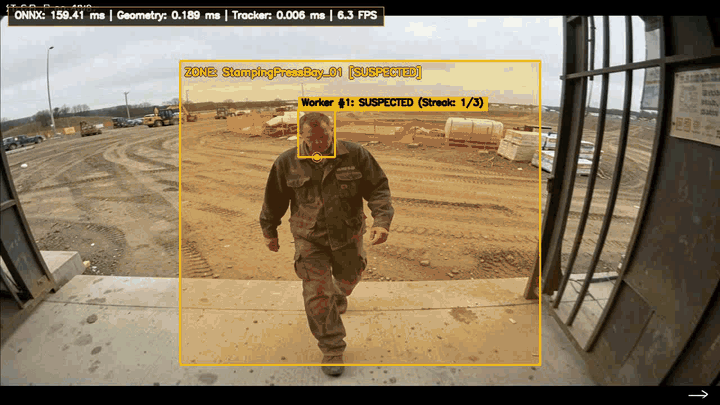
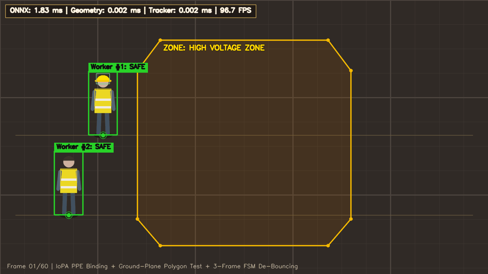

[](https://github.com/nngnamm/industrial-safety-engine/actions/workflows/ci.yml)

| Real Trained YOLOv8n Video Inference (`models/ppe_yolov8n.onnx`) | Synthetic 3-Frame FSM De-Bouncing & Hazard Polygon Telemetry |
| :---: | :---: |
|  |  |

# Real-Time Industrial Worker Safety & Hazard Zone Analytics Engine

An edge-oriented C++17 prototype for computer vision and spatial-temporal safety analytics built on **ONNX Runtime** and **OpenCV 4**. Designed for industrial monitoring workflows (manufacturing presses, high-voltage bays, automated logistics corridors), the engine features pre-allocated contiguous buffer preprocessing, multi-class PPE detection, greedy 1-to-1 containment assignment, polygonal hazard-zone compliance checking with explicit homography validation, a ByteTrack-inspired two-stage confidence tracker with constant-velocity alpha-beta prediction, and consecutive-frame violation de-bouncing across a Producer-Consumer pipeline.

---

## System Architecture

```mermaid
flowchart LR
    Cam["Frame Producer Thread\n(Video File / Live Camera / Synthetic)"] -->|"std::move(cv::Mat)"| Queue["BoundedQueue&lt;cv::Mat&gt;\n(std::mutex + condition_variable)"]
    Queue -->|"Pre-Allocated Buffer View"| Det["ONNX Detector\n(Letterbox + YOLOv8 NMS)"]
    Det -->|"std::vector&lt;Detection&gt;"| Geo["Spatial SafetyAnalyzer\n(Greedy 1:1 IoPA + Point-in-Polygon)"]
    Geo -->|"std::vector&lt;WorkerStatus&gt;"| Trk["WorkerTracker & FSM\n(ByteTrack-Inspired 2-Stage + Alpha-Beta)"]
    Trk -->|"std::vector&lt;TrackedWorker&gt;"| Hud["HUD Renderer & VideoWriter\n(Alpha Zones + AlertState Boxes)"]
```



```text
+--------------------+     push / push_drop_oldest     +---------------------------+
|  Producer Thread   | ------------------------------> |   BoundedQueue<cv::Mat>   |
| (Camera / Video)   |                                 |  (RAII Mutex + CondVars)  |
+--------------------+                                 +-------------+-------------+
                                                                     | pop() -> std::optional<cv::Mat>
                                                                     v
+--------------------+    TrackedWorker    +-------------------------+-------------------------+
| HUD & VideoWriter  | <------------------ |                 SafetyPipeline                    |
|  Alpha Polygons &  |                     |  1. Detector       : Letterbox -> NCHW -> ORT     |
|  AlertState Boxes  |                     |  2. SafetyAnalyzer : Greedy 1:1 IoPA + Homography |
+--------------------+                     |  3. WorkerTracker  : 2-Stage IoU + FSM De-bounce  |
                                           +---------------------------------------------------+
```

---

## Key C++17 Systems & Vision Engineering Highlights

### 1. Pre-Allocated Contiguous Buffer Preprocessing & Zero-Copy ONNX Tensor Wrapping
- **`Detector` (`include/safety_engine/detector.hpp`, `src/detector.cpp`)** implements pre-allocated contiguous buffer preprocessing by allocating its planar `NCHW` buffer (`std::vector<float> input_tensor_values_`) and intermediate `cv::Mat` workspaces (`resized_buffer_`, `letterbox_buffer_`, `float_buffer_`) once during construction.
- During inference, three lightweight `cv::Mat` headers (`CV_32F`) alias offsets directly inside `input_tensor_values_.data()`, allowing `cv::split` to scatter interleaved `HWC` floats straight into planar `NCHW` memory without steady-state heap allocations.
- `Ort::Value::CreateTensor<float>` wraps `input_tensor_values_.data()` in-place before invoking `Ort::Session::Run`.
- **Explicit ONNX Model Contract Validation**: Both constructor initialization and `postprocess()` verify that input tensors are float32 with rank 4 (`[1 or dynamic, 3, H, W]`) and output tensors are float32 with rank 3 (`[1, channels, num_anchors]`) where `channels >= 7` (`4 box coords + 3 PPE classes {Person, Helmet, Vest}`).
- Strict **LIFO member declaration order** guarantees deterministic RAII teardown (`Ort::Session` releases before `Ort::SessionOptions` and `Ort::Env`; `const char*` name views expire before their owning `std::string` buffers), while deleted copy/move operations prevent dangling pointer views.

### 2. Greedy 1-to-1 Containment Assignment (IoPA) & Explicit Ground-Plane Homography
- **`SafetyAnalyzer` (`include/safety_engine/geometry.hpp`, `src/geometry.cpp`)** avoids naive bounding-box IoU failure modes (where a small helmet box inside a large person box yields artificially low IoU) by computing **Intersection-over-PPE-Area (IoPA)** containment:
  $$\text{IoPA}(B_{\text{person}}, B_{\text{ppe}}) = \frac{|B_{\text{person}} \cap B_{\text{ppe}}|}{|B_{\text{ppe}}|}$$
- Performs **greedy 1-to-1 containment assignment** (rather than globally optimal Hungarian matching) across candidate `(person_idx, ppe_idx, score)` pairs sorted under a strict weak ordering (`score` descending, then `std::tie(person_idx, ppe_idx)` ascending), ensuring overlapping `Person` bounding boxes cannot double-claim the same `Helmet` or `Vest` detection.
- Enforces vertical anatomical priors relative to person height (helmets restricted to the upper cranial band $[0.0, 0.35]$, vests restricted to the torso band $[0.15, 0.75]$), rejecting dropped helmets on the floor.
- Supports optional **$3\times3$ Ground-Plane Homography Calibration** (`compute_ground_homography`, `project_point_homography`, `SafetyAnalyzer::set_homography`) via `cv::Matx33f`:
  - `SafetyAnalyzer::set_homography` validates that all entries are finite and `std::abs(cv::determinant(H)) > 1e-9`, throwing `std::invalid_argument` on singular or degenerate matrices.
  - `project_point_homography` returns `std::optional<cv::Point2f>`, explicitly returning `std::nullopt` when $w \to 0$ (`std::abs(w) <= 1e-6f`) or when projected coordinates are non-finite (`NaN`/`Inf`). When projection fails, `WorkerStatus::ground_projection_valid` is set to `false` and hazard-zone evaluation is skipped for that worker rather than comparing raw pixel coordinates against metric ground polygons.

### 3. ByteTrack-Inspired Two-Stage Confidence Tracker with Constant-Velocity Alpha-Beta Prediction
- **`WorkerTracker` (`include/safety_engine/tracker.hpp`, `src/tracker.cpp`)** is a **ByteTrack-inspired two-stage confidence tracker with constant-velocity alpha-beta prediction**:
  - Tracks bounding-box kinematics `(vx, vy, vw, vh)` using an $\alpha$-$\beta$ exponential smoothing filter and matches incoming detections against `TrackedWorker::predict_next_bbox()` via greedy IoU assignment with strict weak ordering (`std::tie(track_idx, worker_idx)` tie-breaking).
  - **Stage 1**: Matches active tracks against high-confidence detections (`person_confidence >= high_conf_thresh_`, default `0.50`).
  - **Stage 2**: Matches remaining unmatched active tracks against low-confidence detections (`person_confidence < high_conf_thresh_`, e.g., partially occluded workers) to mitigate ID switches and track fragmentation, while initializing new tracks strictly from unmatched high-confidence detections.
- Implements a 3-state de-bouncing Finite State Machine (`AlertState::Safe` $\rightarrow$ `SuspectedViolation` $\rightarrow$ `ActiveAlert`) with explicit `DropoutStreakPolicy` (`HoldStreak`, `StrictReset`, `DecayStreak`) and separate `consecutive_observed_violations` and `total_violation_frames` counters.

### 4. Thread-Safe Bounded Producer-Consumer Queue & End-to-End Video Stream Pipeline
- **`BoundedQueue<T>` (`include/safety_engine/frame_queue.hpp`)** coordinates frame ingestion and inference using `std::mutex`, two `std::condition_variable` primitives (`cv_not_empty_`, `cv_not_full_`), move-only payload semantics, and `std::optional<T>` draining (`push` for lossless backpressure, `push_drop_oldest` for real-time low-latency capture).
- **`SafetyPipeline::run_video_stream` (`include/safety_engine/pipeline.hpp`, `src/pipeline.cpp`)** connects `cv::VideoCapture` decoding on the Producer thread with `process_frame` + `render_hud` + optional `cv::VideoWriter` encoding on the Consumer thread, recording stage-by-stage `std::chrono::steady_clock` P50/P95/P99 latency telemetry.

---

## Model Training & Held-Out Validation Metrics (Construction-PPE)

### Dataset Provenance & Class Remapping
- **Source Dataset**: [Ultralytics Construction-PPE](https://docs.ultralytics.com/datasets/detect/construction-ppe/) (`1,132` training images, `143` held-out validation images).
- **Target Schema (`models/ppe_yolov8n.onnx`)**: Remapped and filtered to the 3 core industrial safety classes expected by `safety_engine::Detector`:
  - `0: Person` (`person`)
  - `1: Helmet` (`helmet`)
  - `2: Vest` (`vest`)
- **ONNX Export Contract**: Opset 17, static float32 input `images: [1, 3, 640, 640]` $\rightarrow$ float32 output `output0: [1, 7, 8400]` (`4` box coordinates `[cx, cy, w, h]` + `3` class confidence scores).

### Held-Out Validation Accuracy (`assets/ppe_metrics.json`)

| Class (`class_id`) | Precision ($P$) | Recall ($R$) | mAP@50 | mAP@50-95 |
| :--- | ---: | ---: | ---: | ---: |
| **`0: Person`** | `0.8660` | `0.5779` | `0.6768` | `0.4233` |
| **`1: Helmet`** | `0.9362` | `0.8027` | `0.8711` | `0.6667` |
| **`2: Vest`** | `0.9522` | `0.9324` | `0.9541` | `0.7623` |
| **Overall (All Classes)** | **`0.9181`** | **`0.7710`** | **`0.8340`** | **`0.6174`** |

### Real Trained YOLOv8n (`models/ppe_yolov8n.onnx`) CPU Latency Profile
Measured end-to-end through the C++17 producer-consumer pipeline (`./build/safety_app --benchmark --model models/ppe_yolov8n.onnx --frames 50 --warmup 10` on `1920x1080` `CV_8UC3`, `CPUExecutionProvider`):

```text
Benchmark Mode: Full Neural Network Compute Benchmark (ppe_yolov8n.onnx - multi-layer Conv2D + SiLU + Detect CPU inference)
Benchmark Configuration: 50 timed frames + 10 warm-up frames @ 1920x1080 (BGR8), Queue Capacity = 8
+-----------------------------------+-----------+-----------+-----------+-----------+
| Pipeline Stage                    | Mean (ms) |  P50 (ms) |  P95 (ms) |  P99 (ms) |
+-----------------------------------+-----------+-----------+-----------+-----------+
| Detector (ONNX)                   |    40.379 |    38.023 |    42.466 |    86.068 |
| Spatial Geometry (IoPA + Polygon) |     0.001 |     0.000 |     0.001 |     0.002 |
| Tracker + State Machine           |     0.001 |     0.001 |     0.001 |     0.003 |
+-----------------------------------+-----------+-----------+-----------+-----------+
| Total End-to-End                  |    40.380 |    38.024 |    42.467 |    86.070 |
+-----------------------------------+-----------+-----------+-----------+-----------+
Overall Producer-Consumer Throughput: 24.58 FPS (50 frames, 0 drops)
```

---

## Benchmark & Stage Latency Profiles

`SafetyPipeline::run_multithreaded_benchmark` executes configurable warm-up iterations (`warmup_frames = 10` by default) through the full Detector + Geometry + Tracker pipeline prior to starting `std::chrono::steady_clock` timers so ONNX Runtime arena allocation and thread-pool initialization do not skew steady-state P50/P95/P99 percentiles.

### 1. Pipeline & Memory Overhead Benchmark (`models/dummy_yolo.onnx`)
Isolates C++ pre-allocated contiguous buffer preprocessing, `Ort::Value` tensor wrapping, aspect-ratio letterboxing, `NCHW` planar scatter, spatial geometry, and producer-consumer queue synchronization (`./build/safety_app --benchmark --model models/dummy_yolo.onnx --frames 50 --warmup 10` on `1920x1080` `CV_8UC3`):

```text
Benchmark Mode: Pipeline & Memory Overhead Benchmark (dummy_yolo.onnx - isolates C++ zero-copy tensor wrapping, letterboxing, geometry & thread sync)
Benchmark Configuration: 50 timed frames + 10 warm-up frames @ 1920x1080 (BGR8), Queue Capacity = 8
+-----------------------------------+-----------+-----------+-----------+-----------+
| Pipeline Stage                    | Mean (ms) |  P50 (ms) |  P95 (ms) |  P99 (ms) |
+-----------------------------------+-----------+-----------+-----------+-----------+
| Detector (ONNX)                   |     1.864 |     1.774 |     2.495 |     2.551 |
| Spatial Geometry (IoPA + Polygon) |     0.002 |     0.002 |     0.004 |     0.004 |
| Tracker + State Machine           |     0.003 |     0.002 |     0.004 |     0.007 |
+-----------------------------------+-----------+-----------+-----------+-----------+
| Total End-to-End                  |     1.869 |     1.779 |     2.502 |     2.562 |
+-----------------------------------+-----------+-----------+-----------+-----------+
Overall Producer-Consumer Throughput: 96.04 FPS (50 frames, 0 drops)
```

### 2. Full Neural Network Compute Benchmark (`models/yolov8n_bench.onnx`)
Reports realistic CPU `Conv2D + SiLU + SPPF + Multi-Scale Detect` inference latency across P3/P4/P5 feature pyramids (`./build/safety_app --benchmark --model models/yolov8n_bench.onnx --frames 50 --warmup 10` on `1920x1080` `CV_8UC3`):

```text
Benchmark Mode: Full Neural Network Compute Benchmark (yolov8n_bench.onnx - multi-layer Conv2D + SiLU + Detect CPU inference)
Benchmark Configuration: 50 timed frames + 10 warm-up frames @ 1920x1080 (BGR8), Queue Capacity = 8
+-----------------------------------+-----------+-----------+-----------+-----------+
| Pipeline Stage                    | Mean (ms) |  P50 (ms) |  P95 (ms) |  P99 (ms) |
+-----------------------------------+-----------+-----------+-----------+-----------+
| Detector (ONNX)                   |    19.021 |    17.420 |    39.542 |    48.730 |
| Spatial Geometry (IoPA + Polygon) |     0.006 |     0.004 |     0.015 |     0.019 |
| Tracker + State Machine           |     0.005 |     0.003 |     0.012 |     0.015 |
+-----------------------------------+-----------+-----------+-----------+-----------+
| Total End-to-End                  |    19.032 |    17.434 |    39.559 |    48.736 |
+-----------------------------------+-----------+-----------+-----------+-----------+
Overall Producer-Consumer Throughput: 46.04 FPS (50 frames, 0 drops)
```

---

## Build, Test & Verification Guide

### Prerequisites
- **CMake** $\ge 3.16$
- **C++17 Compiler**: GCC $\ge 9$, Clang $\ge 10$, or MSVC 2019+ (`-Wall -Wextra -Wpedantic` clean)
- **OpenCV 4** (`core`, `imgproc`, `highgui`, `videoio`, `dnn`)
- **ONNX Runtime C++ SDK** (located via `-DONNXRUNTIME_ROOT_DIR=/path/to/onnxruntime` or `ENV{ONNXRUNTIME_ROOT_DIR}`)
- **Python 3** (for deterministic synthetic and Conv2D ONNX benchmark model generation; zero external pip packages required)

### 1. Generate the Test & Benchmark ONNX Models
```bash
python3 scripts/create_dummy_yolo_onnx.py
python3 scripts/create_realistic_yolov8n_onnx.py
```

### 2. Release Build & Unit Test Suite (GoogleTest + CTest)
```bash
cmake -S . -B build \
  -DCMAKE_BUILD_TYPE=Release \
  -DONNXRUNTIME_ROOT_DIR="$(pwd)/third_party/onnxruntime"

cmake --build build -j"$(nproc)"
ctest --test-dir build --output-on-failure
```

### 3. AddressSanitizer & UndefinedBehaviorSanitizer Verification (`ENABLE_ASAN`)
Verify zero memory leaks, buffer overflows, dangling references, or undefined behavior across all unit and multi-threaded integration tests:
```bash
cmake -S . -B build_asan \
  -DCMAKE_BUILD_TYPE=RelWithDebInfo \
  -DENABLE_ASAN=ON \
  -DONNXRUNTIME_ROOT_DIR="$(pwd)/third_party/onnxruntime"

cmake --build build_asan -j"$(nproc)"
ctest --test-dir build_asan --output-on-failure
./build_asan/safety_app --benchmark --frames 25 --warmup 5
```

### 4. Run End-to-End Video / Live Camera Inference & CLI Benchmarks
```bash
# 1. End-to-end video file inference with trained PPE YOLOv8n model and HUD overlay output
./build/safety_app --video assets/ppe_test_stream.mp4 --output assets/ppe_real_inference.mp4 --model models/ppe_yolov8n.onnx

# 2. Live camera inference (webcam index 0) with optional frame cap
./build/safety_app --video 0 --output live_hud.mp4 --model models/ppe_yolov8n.onnx --max-frames 300

# 3. Real Trained YOLOv8n PPE Model Benchmark (ppe_yolov8n.onnx)
./build/safety_app --benchmark --model models/ppe_yolov8n.onnx --frames 50 --warmup 10

# 4. Pipeline & Memory Overhead Benchmark (dummy_yolo.onnx)
./build/safety_app --benchmark --model models/dummy_yolo.onnx --frames 50 --warmup 10

# 5. Synthetic Conv2D Neural Network Compute Benchmark (yolov8n_bench.onnx)
./build/safety_app --benchmark --model models/yolov8n_bench.onnx --frames 50 --warmup 10

# 6. Export 60-frame 1280x720 industrial floor HUD demo sequence
./build/safety_app --export-demo demo_frames

# 7. Custom stress test + save rendered HUD overlay image
./build/safety_app \
  --benchmark \
  --model models/dummy_yolo.onnx \
  --frames 200 \
  --warmup 10 \
  --width 1920 \
  --height 1080 \
  --queue-capacity 8 \
  --save-hud hud_preview.png
```

---

## Repository Structure

```text
.
├── CMakeLists.txt                       # C++17 build configuration, Threads, ONNX Runtime & ENABLE_ASAN
├── LICENSE                              # MIT License
├── assets/
│   ├── hud_demo.gif                     # 60-frame 1280x720 synthetic HUD telemetry & FSM de-bouncing demo
│   ├── ppe_metrics.json                 # Held-out Construction-PPE validation Precision/Recall/mAP metrics
│   ├── ppe_real_demo.gif                # Real trained YOLOv8n PPE video inference & HUD demo (< 3 MB)
│   ├── ppe_real_inference.mp4           # Annotated output video from safety_app + ppe_yolov8n.onnx
│   └── ppe_test_stream.mp4              # Multi-scene held-out test video stream (1280x720)
├── models/
│   └── ppe_yolov8n.onnx                 # Real trained 3-class YOLOv8n PPE detector ([1,3,640,640] -> [1,7,8400])
├── include/safety_engine/
│   ├── types.hpp                        # Core domain structs (Detection, HazardZone, WorkerStatus)
│   ├── version.hpp                      # Engine semantic version metadata
│   ├── detector.hpp                     # RAII pre-allocated ONNX Runtime YOLOv8 detector & contract checks
│   ├── geometry.hpp                     # Greedy 1:1 IoPA PPE matching, 3x3 homography & SafetyAnalyzer
│   ├── tracker.hpp                      # ByteTrack-inspired 2-stage tracker, alpha-beta & DropoutStreakPolicy
│   ├── frame_queue.hpp                  # Thread-safe BoundedQueue<T> template
│   └── pipeline.hpp                     # SafetyPipeline, video stream runner, HUD renderer & profiler
├── src/
│   ├── version.cpp
│   ├── detector.cpp
│   ├── geometry.cpp
│   ├── tracker.cpp
│   ├── pipeline.cpp
│   └── main.cpp                         # CLI for real video/camera inference & latency benchmarks
├── scripts/
│   ├── create_dummy_yolo_onnx.py        # Zero-dependency minimal ONNX graph generator (pipeline overhead)
│   └── create_realistic_yolov8n_onnx.py # 3-class Conv2D + SiLU + SPPF + Detect ONNX generator & validator
└── tests/
    ├── CMakeLists.txt                   # GoogleTest discovery
    ├── test_smoke.cpp                   # Toolchain & version sanity tests
    ├── test_detector.cpp                # Letterbox math, ONNX contract validation & end-to-end ORT tests
    ├── test_geometry.cpp                # Greedy 1:1 PPE assignment, degenerate homography & polygon tests
    ├── test_tracker_and_queue.cpp       # Velocity prediction, ByteTrack stage-2, dropout policies & queue tests
    └── test_pipeline.cpp                # End-to-end video file inference, HUD rendering & FPS benchmarks
```
